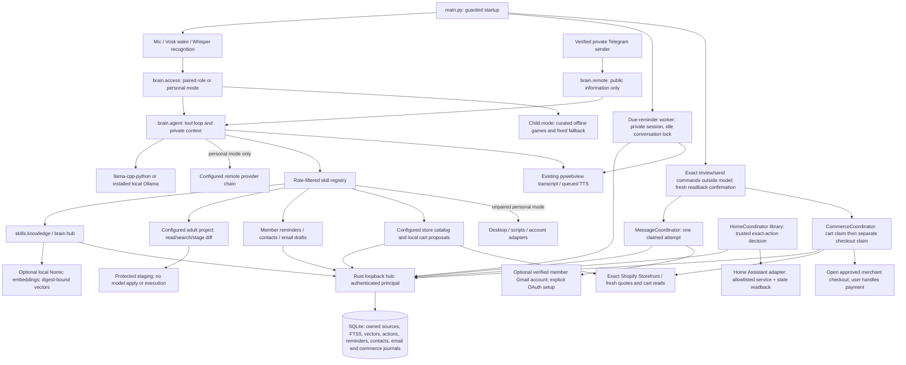

# EDITH runtime architecture

Updated 20 November 2026. The existing overlay is reused; no new UI is required. This graph describes the current implementation, not the complete household target.

- Paired clients have server-mapped adult/elder/child/guest credentials. A token authenticates a client, not the person speaking. Shared listening defaults to guest; trusted member interaction is still required.
- Paired input uses local inference from the first turn. Retrieved private context also restricts subsequent tools; it is not sent to a cloud model or copied into the legacy global memory store.
- RAG combines permission-filtered FTS5 and optional local vector search. Source revisions and paired identity are revalidated before/after inference and before tools; stale context is cleared. Broader parsers and full token budgeting remain further work.
- Personal-mode host scripts/desktop inputs remain outside the household boundary. They are not an isolated coding worker.
- HomeCoordinator is implemented and integration-tested as a backend library, but is not exposed as an LLM approval tool. Home Assistant setup is deferred; no physical devices are configured.
- The action journal distinguishes proposal, approval, execution claim and verified/failed/unknown result. Recovered interrupted execution is unknown, not automatically retried.
- TTS has a bounded worker queue, cancellable generations and stale-answer admission checks. Existing mute cancels capture/output/future agent work. Native acoustic barge-in and interruption of already-running blocking calls remain unverified.
- Configured child mode uses fixed offline games without model calls. Elder wording, local speech-rate controls and durable one-time reminders are integrated; parent controls and delegation remain unfinished.
- Reminder speech uses a leased record and tracked TTS completion; at-least-once announcement is not proof the person heard or performed the task. Wake recognition excludes current speech and preserves the accepted audio snapshot through conversation admission.
- Contacts and drafts are member-owned. Exact recipient/content approval is outside the model. Gmail acceptance is not delivery; interrupted or ambiguous sends are never automatically retried. Personal Google credentials are not inherited by household mode.
- Own-store Shopify configuration, catalog-derived local proposals and the central commerce journal are connected to exact voice review. Cart preparation and checkout opening require separate confirmations and single claims. Fresh price/cart checks reject changes. Provider/browser effects were synthetic in acceptance tests; no real merchant or paid-order reconciliation is connected.
- WhatsApp Business is the user-selected first contact channel. Protected token/account verification and approved-template adapters are implemented and default to denial without trusted policy/approval. Central consent/message journals, signed events and voice-send integration remain unfinished; no WhatsApp model tool or real account is connected. Optional Gmail is separate.

See the [runbook](docs/product-plan/central-engine-runbook.md) and [full target blueprint](docs/product-plan/household-agent-blueprint.md). The separate unfinished `prototype/` is not this runtime.
