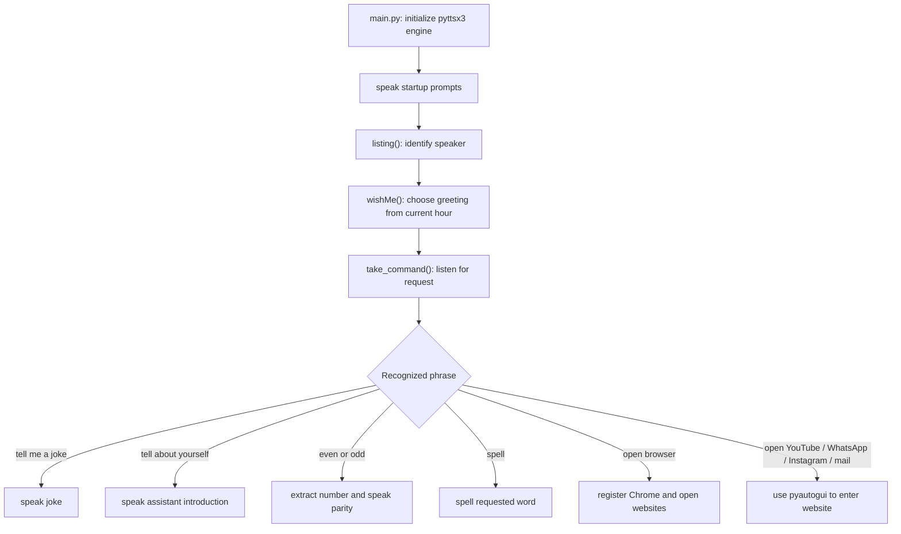
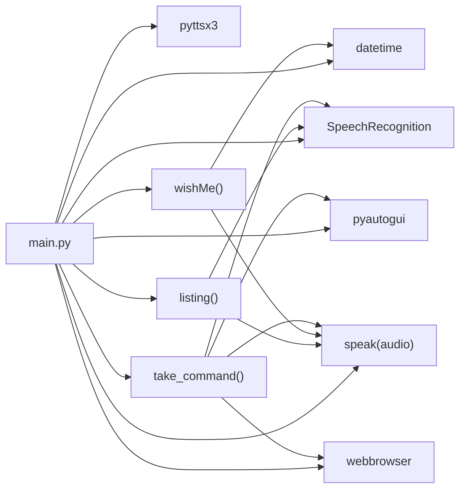

# Repository graph

This graph covers the project's application source and runtime dependencies. The checked-in `venv/` contains third-party environment files and is not part of the application graph.

## Runtime flow

## Code and dependency relationships

`main.py` invokes the startup sequence at module scope: it initializes speech synthesis, greets the user, runs speaker identification, announces a time-based greeting, and then listens for one command.
