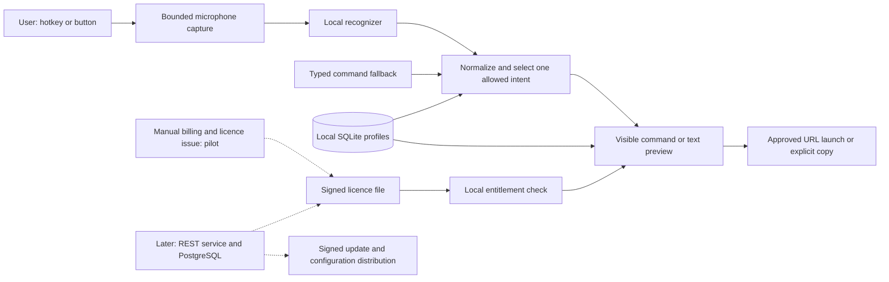

# EDITH: plan for a sellable Windows product

> **Historical market proposal.** This plan uses commit `60fa113` and the earlier small-business scope. The repository has since advanced to `a006344`, and the [household blueprint](household-agent-blueprint.md) preserves the expanded vision. Use the [updated code assessment](updated-code-assessment.md) for present capabilities; the old code counts, gaps and proposed prices below are not current implementation or validated market facts.

20 November 2026 · Based on commit `60fa1132886b343e10a889f86307a1d5a2ac7886`

**Recommendation:** build toward a supported Windows workflow assistant for small businesses. Start with a paid, tightly scoped setup service for three repeatable office tasks. Turn that service into a subscription only after customers use it and renew. The current repository is a prototype, not a release candidate.

The user selected **small businesses using Windows PCs** as the first market. The narrower segment, feature scope, prices and milestones below are recommendations to test, not previously agreed customer requirements or proven market demand. This plan concerns EDITH only; it does not import the clothing-franchise project's requirements or budget.

## 1. What exists, and what would be sold

The repository contains 3,056 tracked files, but 3,045 belong to a copied virtual environment. The application is **102 lines in `main.py`**. It records a name and one voice command, speaks responses, checks some numbers and opens fixed websites. There is no GUI, installer, billing, persistent command loop or business integration. Several commands are broken. The speech path sends recordings to an external endpoint. See the [evidence-based assessment](repository-assessment.md) and [complete file inventory](repository-file-inventory.csv).

The product offer should be:

> **EDITH helps small Windows teams launch their workspaces and prepare approved replies and notes using a few voice shortcuts, with setup and support included.**

This is proposed positioning. Do not advertise autonomous AI, universal computer control, offline operation, Indian-language accuracy, or guaranteed time savings until the shipped version proves those claims. EDITH is a working name; clear brand/domain rights before spending on a public launch. The MIT source is not an exclusive competitive asset.

## 2. Three realistic commercial paths

| Path | Advantages | Main difficulty | Decision |
|---|---|---|---|
| General consumer voice assistant | Large potential audience; easy demo story | Built-in and mature competitors already provide dictation/control; support across arbitrary apps is expensive | Defer |
| Supported workflows for small Windows offices | Specific tasks can be measured; setup/support can earn revenue; repeated configurations can become a product | Must demonstrate savings over keyboard shortcuts and existing tools; customization can consume margin | **Recommended** |
| Educational kit and workshops | Closest to today's prototype; transparent sale of teaching/customization | Different buyer and business; little recurring software value | Fallback if business pilots do not renew |

Selling a tutorial or setup service is legitimate if described accurately. Packaging the current script as a finished commercial assistant would overstate its capability.

## 3. Competition and differentiation

Official sources checked on 20 November 2026. USD prices below remain in USD; they are not converted using an assumed live exchange rate.

| Product | Verified public offer | Consequence for EDITH |
|---|---|---|
| Microsoft Voice Access | Windows 11 feature for app control and text authoring; recognition works on-device after language download | Basic voice opening/typing is already available within Windows. [Microsoft](https://support.microsoft.com/en-us/accessibility/windows/voice-access/set-up-voice-access) |
| Apple Voice Control | Mac control with audio processing on the device | Privacy alone is not a unique product promise. [Apple](https://support.apple.com/en-hk/guide/mac-pro/apd4c143b3c5/mac) |
| Wispr Flow | Pro: **US$15/user/month**, or **US$12/user/month billed annually**; dictation, vocabulary and snippets; limited free usage | Dictation and snippets alone are not a distinct offer. [Pricing](https://wisprflow.ai/pricing) |
| Superwhisper | Windows support; free local Whisper dictation; Pro **US$8.49/month**, **US$84.99/year**, or **US$249.99 lifetime** | A generic offline Windows dictation subscription faces strong price competition. Hardware affects local-model availability. [Windows offer](https://superwhisper.com/voice-to-text-windows) |
| Talon | Free speech engine and scriptable commands on Windows, macOS and Linux/X11 | Custom voice commands already exist; easier setup and a supported business outcome must earn the price. [Official documentation](https://talonvoice.com/docs/reference/official.html) |

**Potential differentiation to validate:** a ready-to-use workflow for one kind of office, configured in under an hour, with a small command vocabulary, clear previews, reliable updates and a person accountable for fixing it. This is a service and usability hypothesis, not a claim that competitors cannot offer it. Do not compete on the label “AI.”

## 4. First customers and first three workflows

Start with **small customer-service or digital-service agencies with 3–10 Windows users** in a market you can reach personally. This is an initial segment proposal within the user's chosen small-business market. Avoid medical, financial-advice and other sensitive decision-making workflows in the first release: the prototype has no domain controls for those tasks.

Observe work before finalizing the pack. Candidate workflows:

1. **Start my workspace:** open a customer-approved set of HTTPS URLs in the default browser. No credentials embedded in configuration; users sign in normally.
2. **Prepare a standard reply:** choose an office-approved template, fill explicit fields, show a preview and copy it. The user pastes and sends it. No reading inboxes or sending messages automatically.
3. **Prepare a work note:** choose a structured note template and fill it in EDITH, then preview/copy. Free-form spoken dictation is optional after recognition performance is proven; typed fields remain available.

The pilot supports EDITH's own window and approved URLs opened in the default browser. It does not promise automation inside every CRM, Tally, WhatsApp, Excel or browser page. A URL to a system is not an integration with that system.

The buyer is the owner or operations lead; the daily user is the employee. Interview both. The buying reason must be measured reductions in repetitive work and training/support effort, not novelty.

## 5. Validate before building a broad product

Run a two-week discovery and offer test, using permission-based conversations arranged by the owner. No outreach has been sent during this assessment.

- Interview **10 qualified prospects** and observe **5 real workflows**. Record task frequency, current time, applications, device specifications, mistakes and privacy constraints. Use synthetic examples in demonstrations.
- Compare the proposed experience with the customer's current shortcuts, templates and Windows Voice Access. A slower voice shortcut is not a benefit.
- Obtain **3 paid pilot commitments** after demonstrating a safe working version and explaining the limits. Before that version exists, collect expressions of interest, not claims of a delivered product. If taking a reservation, state the delivery condition and refund terms explicitly.
- Keep the same three workflows for these pilots. Bespoke work outside the pack gets a separate estimate, not an unlimited-support promise.

**Proceed to a wider release only if:** at least 2 of 3 pilot businesses renew at the quoted recurring price; at least 60% of assigned seats use a core workflow on 3 working days/week by week four; users achieve at least 20% median net task-time reduction on the selected workflow, including corrections/review; and ongoing support averages no more than 20 minutes per seat per month after onboarding. These are proposed decision thresholds, not statistics.

Use consented timing observations or aggregate counters, not stored employee audio, message bodies or covert monitoring. If the thresholds fail, simplify the workflow or sell a bounded setup/training service. Do not add a general chatbot to hide weak demand.

## 6. Product boundary for the first paid release

| Include | Defer |
|---|---|
| Windows 11 x64, one tested release channel | macOS/Linux/mobile, ARM support, arbitrary legacy Windows versions |
| Push-to-talk button and hotkey; visible listening/cancel state | Always-listening wake word |
| Small editable command vocabulary; one intent per utterance | Autonomous task planning or arbitrary shell/code execution |
| Three approved workflow types above; preview/copy and keyboard fallback | Sending messages, making payments, deleting files, changing system settings |
| English command set tested with target users' accents | Claimed Telugu/Hindi/multilingual support before separate validation |
| Local configuration and local recognition as the preferred target | Guaranteed performance on every PC or silent cloud fallback |
| Safe installer/update/uninstall, licence entitlement, help and logs without content | Enterprise SSO, multi-region cloud, advanced admin analytics |

The installer and local recognition are **new work**. All included product features need implementation and acceptance testing; existing imports do not establish readiness.

## 7. Proposed technical design

Keep Python for the first version because it fits the existing prototype and speech tooling. Rebuild the application structure rather than expanding the current chain of `if` statements.

| Component | Proposed choice | Reason and constraint |
|---|---|---|
| Desktop runtime | Python 3.13, exact supported versions locked after a compatibility spike | Existing Python code is small; do not run the old Python 3.9 environment. The old SpeechRecognition imports `audioop`, removed in 3.13, so copying old dependencies is not an upgrade strategy. |
| Desktop UI | PySide6, limited to reviewed LGPL-compatible modules and packaging | Good desktop controls and tray/status UI. A licence/packaging gate is mandatory; this is not a blanket licence clearance. |
| Speech input | A replaceable recognizer interface; evaluate local `faster-whisper` CPU/int8 on target PCs | Avoids per-minute cloud inference charges when local performance works. Benchmark the model and exact native dependencies; do not promise model accuracy from a library benchmark. |
| Spoken output | Optional Windows-native speech adapter with reviewed dependencies | Replace the bundled GPL-declared pyttsx3 copy if a proprietary distribution is intended; visual status is sufficient for the first pilot. |
| Workflow engine | Validated declarative profiles, explicit command routing, allowlisted action types | No arbitrary scripts, evaluated code, coordinate clicks or implicit chained actions |
| Local persistence | SQLite for profiles/settings; Windows credential storage for secrets if later needed | No shared MongoDB server is needed for desktop settings. Avoid storing customer passwords at all. |
| Pilot entitlement | Manually issued, signed, expiring licence file and ordinary invoices/payment links | Three businesses do not require an account-management SaaS. Keep signing keys out of the client. |
| Later service | FastAPI implementing HTTPS REST; PostgreSQL for organizations, seats, entitlements, payment events | REST is the interface style; FastAPI is its Python implementation. gRPC and microservices offer no demonstrated benefit here. |
| Distribution | Reproducible Windows build, signed installer and signed update manifest, rollback | Ship a clean release artifact, never the tracked `venv/`. A small website provides documentation, plans and downloads. |

The [faster-whisper project](https://github.com/SYSTRAN/faster-whisper) documents CPU int8 usage and its code has an [MIT licence](https://github.com/SYSTRAN/faster-whisper/blob/master/LICENSE). That does not clear every model, codec or transitive binary. Qt's [LGPL obligations](https://www.qt.io/development/open-source-lgpl-obligations) include notices, corresponding library source/access and user replacement/relinking rights; some modules are GPL-only. The release owner must approve the actual packaged dependency set, not just a framework name.

Raw microphone audio stays in volatile memory and is discarded after recognition in the proposed local mode. Disable content logging. Diagnostics contain version, duration, error category and workflow ID only, with an explicit opt-in export. Local processing must be verified with network-disabled tests; the existing application does not meet this design.

If local recognition cannot meet the agreed hardware/latency target, offer an explicit, usage-capped cloud mode only with customer approval and revised economics. Show the provider and what is transmitted; require HTTPS, a production account, timeouts, spend limits and a deletion/retention policy. Never silently switch local users to cloud processing. Do not embed a shared paid API key in a distributed executable.

For a later cloud mode, authenticate requests to the REST broker; enforce per-seat and per-organization quotas before forwarding audio. Keep provider secrets on the server. For team licensing, validate tenant membership server-side and verify billing webhook signatures/idempotency; a client-supplied tenant ID cannot grant access. Local core workflows should tolerate a short signed entitlement grace period during outages. Cancellation ends renewal; users retain export access to their own templates. Offline licence files deter casual misuse but cannot provide perfect revocation or tamper resistance.

## 8. Pricing to test

These are **proposed India-market prices**, not validated willingness to pay. Quote applicable tax separately after confirming the business's invoicing treatment. Do not carry over the unrelated clothing-vendor subscription price automatically.

| Offer | Suggested test price | Exact scope |
|---|---:|---|
| Initial setup | **₹4,999 per business once** | Up to 5 PCs, three standard workflows, one onboarding session, up to three total delivery hours and one revision round; extra work estimated separately |
| Paid pilot / ongoing core | **₹999 per licensed PC/month**, minimum 3 seats | Minimum ₹2,997/month; local recognition, supported standard workflow pack, updates and business-hours support; no cloud speech allowance or custom integrations |
| Later annual plan | Consider only after renewals establish value | Discount must be tested against support and usage costs; no lifetime promise for recurring services |
| Custom integration / cloud speech | Separate approved quote or prepaid capped add-on | Estimate delivery hours and vendor usage; do not promise unlimited AI or cloud minutes |

A **seat means one licensed Windows PC**, including a shared office workstation; billing counts allocated licences, not how often someone speaks. A customer can transfer a seat to a replacement PC through support after retiring the old activation. Set seat-count changes at the next monthly renewal, with a three-seat minimum; this is a proposed contract rule to include in the pilot terms. Each signed pilot licence expires at the end of its paid invoice period, followed by a seven-calendar-day grace period for renewal/support problems; after that, disable new workflow execution while keeping settings/template export available. No automatic renewal charge occurs during the manually billed pilot. Do not collect employee identities simply to count seats.

Issue an ordinary first-month invoice and collect payment after the working pilot and acceptance terms are agreed. Use manually reconciled payment links initially; recurring mandates and automated provisioning are later work. Define support hours, cancellation, failed-payment handling, data export and a fair pilot refund policy before collecting money. A licence purchase must not imply an unavailable feature.

## 9. Running costs and unit economics

The intended core processes speech on customer PCs, so **seat count does not equal simultaneous cloud inference load**. The early service needs downloads, invoices, support and entitlements. Do not rent GPUs or deploy Kubernetes for this version.

Use a **₹5,000/month planning envelope for fixed non-labor operations**, not a provider quote or a guarantee:

| Planning allowance | Monthly amount |
|---|---:|
| Modest web/API hosting when needed, database capacity and backup storage | ₹1,500 |
| Domain/email/download storage/monitoring | ₹500 |
| Windows signing/distribution reserve | ₹1,500 |
| Tax, exchange-rate, renewal and operating contingency | ₹1,500 |
| Total fixed non-labor allowance | **₹5,000** |

Manual pilot licensing can avoid a VPS initially. For comparison, Hostinger currently advertises KVM 1 at ₹599/month **only with ₹14,376 paid for 24 months**, renewing at ₹999/month for the same term; it includes weekly backups. This is not a ₹599 month-to-month bill. Check final tax/checkout terms, and fund independent database backups if using a server. Avoid a long prepayment until the pilot validates demand. [Hostinger pricing](https://www.hostinger.com/in/vps-hosting)

**Signing is an unresolved procurement cost, not a verified ₹1,500 quote.** Microsoft's current Artifact Signing public-trust eligibility list does not include Indian organizations or Indian individual developers; selecting a different Azure region does not establish eligibility. Obtain an eligible code-signing provider quote or validate a suitable Store distribution route before committing to a public delivery date. Adjust the budget if the annual upfront cost exceeds the reserve. [Microsoft prerequisites](https://learn.microsoft.com/en-us/azure/artifact-signing/quickstart)

For a paid hosted rollout, keep database backups outside the server, test a restore monthly, monitor uptime/disk/payment failures, apply security updates and keep a rollback build. Proposed pilot targets are a daily backup with a 24-hour recovery-point objective and recovery within one business day; these are design goals, not an SLA already achieved. Growth decisions should use API latency, disk use, failed updates and support burden, not a guessed vendor limit.

### Example economics for the local-recognition plan

Assumptions, all explicit:

- Revenue ₹999 per seat/month before sales taxes. No annual discount or setup revenue included.
- Payment reserve **₹30/seat/month**. Razorpay's standard gateway lists 2% plus applicable GST on successful payments and no setup/AMC; actual method, account and optional service pricing can vary. The reserve is a rounded modeling assumption covering ordinary gateway charges, not a quotation or an automatic-subscriptions price. [Razorpay pricing](https://razorpay.com/pricing/)
- Ongoing support reserve **₹150/seat/month**, representing 18 minutes at an assumed labor value of ₹500/hour. Measure it; doubling support time reduces contribution by ₹150/seat.
- Refund/service-credit reserve **₹30/seat/month**. Actual rates are unknown.
- Cloud speech cost **₹0** only for successful local recognition. Customer hardware/electricity still has a cost.
- Contribution before fixed expenses: **₹999 − ₹30 − ₹150 − ₹30 = ₹789/seat/month**.
- Fixed non-labor allowance ₹5,000, plus **₹6,000/month maintenance labor** (12 hours at ₹500/hour). These exclude initial development, sales time, travel, income tax and acquisition spend.

| Paid seats | Subscription revenue | After variable reserves and ₹5,000 fixed non-labor costs | After another ₹6,000 maintenance-labor allowance |
|---:|---:|---:|---:|
| 10 | ₹9,990 | ₹2,890 | **−₹3,110** |
| 25 | ₹24,975 | ₹14,725 | **₹8,725** |
| 50 | ₹49,950 | ₹34,450 | **₹28,450** |
| 100 | ₹99,900 | ₹73,900 | **₹67,900** |

Under these assumptions, operating break-even is **14 paid seats**: `ceil(11000 / 789)`. That is not full business profitability: founder sales/development time, acquisition and income taxes remain excluded. A sensitivity case at 36 support minutes/seat instead of 18 reduces contribution to ₹639 and raises this break-even to 18 seats. Do not call revenue “profit.”

Onboarding is also labor: ₹4,999 less three hours at ₹500 leaves ₹3,499 before payment costs, travel, tax and revisions. Cap and track it. Do not use one-time setup receipts to disguise weak recurring margins.

### Why unlimited cloud speech is risky

Google Cloud Speech-to-Text V2 standard lists **US$0.016/audio minute** in its first volume tier. Its discounted asynchronous batch tier is not the right basis for interactive voice commands. [Google pricing](https://cloud.google.com/speech-to-text/pricing)

| Monthly audio per seat | Speech API cost | At a deliberate budget assumption of ₹100/US$, before provider taxes |
|---:|---:|---:|
| 100 minutes | US$1.60 | ₹160 |
| 300 minutes | US$4.80 | ₹480 |
| 1,000 minutes | US$16.00 | ₹1,600 |

₹100/US$ is a stress-planning assumption, **not the current exchange rate**. Add retries, taxes, hosting and support. At 300 minutes, the modeled ₹789 contribution falls to at most ₹309 before extra cloud taxes/costs; at 1,000 minutes the API alone exceeds ₹999 revenue. The prototype's generic Google key is not this production API and must not be budgeted as guaranteed free commercial speech recognition.

## 10. Delivery phases and acceptance gates

Estimates assume one experienced full-time developer plus the founder for sales and testing. They are sequencing estimates, not a fixed delivery promise; customer availability, signing and licence resolution can extend them. The current code does not justify a “90% finished” claim.

| Phase | Indicative time | Deliverables | Gate to continue |
|---|---|---|---|
| 0: Validate job and price | Weeks 1–2 | Interviews, observed baseline, three-workflow scope, demo script, proposed pilot terms | At least three qualified businesses agree the problem is worth testing; choose one repeatable workflow pack |
| 1: Build safe pilot | Weeks 3–6 | Clean dependency set, modern Windows build, push-to-talk UI, local recognition benchmark, routing, previews/copy, typed fallback, safe URL actions, signed installer, supervised signed updates and tested rollback | Clear licences for shipped components; working installation on target PCs; passing applicable pilot gates below; signing available for the actual pilot artifact |
| 2: Operate paid pilots | Weeks 7–10 | Three paying businesses, manually issued licences, onboarding, measured usage/time savings, error/support tracking | At least two renewals and the adoption, savings and support thresholds in section 5 |
| 3: Productize delivery | Weeks 11–14 | Automated reproducible builds and self-service update/rollback, docs, billing/entitlement service if justified, support runbook, restore tests, public pricing | Passing full applicable release checklist and repeatable onboarding; real contribution margin supports acquisition |
| 4: Expand selectively | After repeatable renewals | Team administration, a narrowly justified integration, additional languages or cloud option | Separate demand, accuracy, licence/privacy and cost validation for each expansion |

Do not spend the whole roadmap budget before Phase 0. A 14-week engineering schedule is not a forecast of customer sales.

### Pilot and public-release checks

Before a paid pilot, the desktop speech, action-boundary, latency, privacy, reliability and delivery checks below apply, including signed installation and a supervised update/rollback. Manual licensing must be tested too. Server/payment-webhook and server-backup checks apply when those components are introduced; they are not prerequisites for a pilot with no such backend. Before a public self-service release, repeat the relevant checks on the release artifact and verify the automated delivery path.

- **Speech/commands:** create a held-out set of at least 300 intended commands from 10 representative consenting speakers; ≥95% correct completed tasks in the supported quiet-office conditions, with correction time recorded. These thresholds must be met by the installed artifact, not only parser tests.
- **Action boundaries:** at least 500 negative, ambiguous, repeated and interrupted inputs; no unintended action in that test set. Unknown/low-confidence commands stop with a choice or typed fallback. A passing sample is not a guarantee of zero real-world failures.
- **Latency:** propose warm p95 ≤2 seconds from push-to-talk release to command preview on the agreed reference PC; report cold-start separately. Start evaluation at Windows 11 x64 with 8 GB RAM and ordinary CPU/no discrete GPU; publish only hardware actually validated. Raise the minimum or change the model if the gate fails.
- **Privacy:** no raw audio/transcript files by default; local recognition still works with network blocked after model installation; update/licence traffic contains no command content; explicit consent and caps for any cloud option.
- **Reliability:** microphone missing/unplugged, permission denied, silence, long speech, network loss, duplicate hotkeys, sleep/resume and cancellation recover without unrequested actions or a forced reinstall.
- **Delivery:** install/update/rollback/uninstall as a standard user on at least three representative Windows PCs; validate publisher signatures and update hashes; do not tell users to disable antivirus to install.
- **Entitlements/payments:** if a server is introduced, test forged/duplicate billing webhooks, seat limits, cross-organization requests, cancelled subscriptions, grace periods and export after expiry. No claim that this backend exists today.
- **Operations:** verify a real backup restore, diagnostics redaction, licence issuance/revocation procedure, support contact and release rollback. Publish an attainable support response window; avoid a 24/7 SLA without staff.

## 11. Sales motion and launch assets

The founder's first sales channel should be direct demonstrations to the selected office segment, followed by referrals from renewing customers. Avoid paid advertising until conversion and retention are measurable.

Prepare a 90-second demonstration using synthetic customer information: show the old task, EDITH's command/preview, completion, and measured elapsed time. The initial website needs the exact supported tasks, tested hardware, processing/privacy explanation, price, support scope, trial terms and a demo request. Any demo must use the working pilot; label mockups as concepts.

Track qualified conversations → demos → paid pilots → renewals → referred businesses. Do not forecast conversion rates before observing them. At the example ₹789 contribution, a proposed acquisition ceiling for a three-seat business is roughly ₹4,734 for two months of contribution before fixed costs; actual retention and support cost should drive the ceiling. Include founder sales hours in that calculation.

Offer a short, bounded pilot with a plain cancellation/refund policy. Treat setup, subscription and optional cloud consumption as separate invoice items. Case studies and testimonials require customer permission; no customer outreach or publishing is authorized or performed by this document alone.

## 12. Immediate implementation backlog

This is work to do next, not work completed in this assessment:

1. Preserve the current snapshot; replace the committed environment in a development branch with a clean dependency manifest, lock file, root ignore rules and minimal package layout.
2. Remove offensive responses and the hardcoded personal/music content. Extract pure command parsing from all microphone/UI side effects; introduce an explicit application entry point.
3. Define the three workflow schemas and a single-intent state machine: idle → listening → recognizing → preview → confirmed action / cancelled / error.
4. Build bounded microphone capture, typed fallback, visible status and recognizer abstraction; benchmark local recognition on customer-class hardware before UI polish.
5. Implement approved URL launch and preview/copy templates; reject arbitrary shell actions and imported executable workflows.
6. Complete exact-version licence review, minimal native dependencies, notices/model provenance and Windows build/signing procurement.
7. Add only meaningful parser/state-machine tests and installed end-to-end acceptance scenarios; document measured failures and supported limitations.
8. Run the three paid pilots with manual licences/invoices. Build team SaaS/billing automation only after pilot evidence justifies the complexity.

## 13. Decisions and remaining uncertainties

**Decided by the user:** small businesses using Windows PCs are the initial market; review the repository and produce a commercial plan.

**Recommendations made here:** service-led validation; small agencies as the first segment; Windows 11 x64; three safe workflows; local recognition first; ₹4,999 setup and ₹999/seat/month with a three-seat minimum; no LLM for the core workflow.

**Unproven:** customer willingness to pay, task savings, speech accuracy/latency on target hardware, signed distribution cost/eligibility, final dependency compatibility, actual support volume and final tax/invoicing treatment. Resolve these at the specified gates. No revenue, performance, legal clearance or product-readiness guarantee is implied.

The next business action is five observed workflows and a price conversation. The next engineering action is a clean, safe Windows pilot with a measured speech path. The product should earn a wider build through repeated use and renewals.
