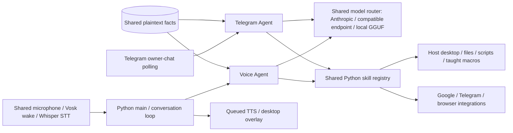
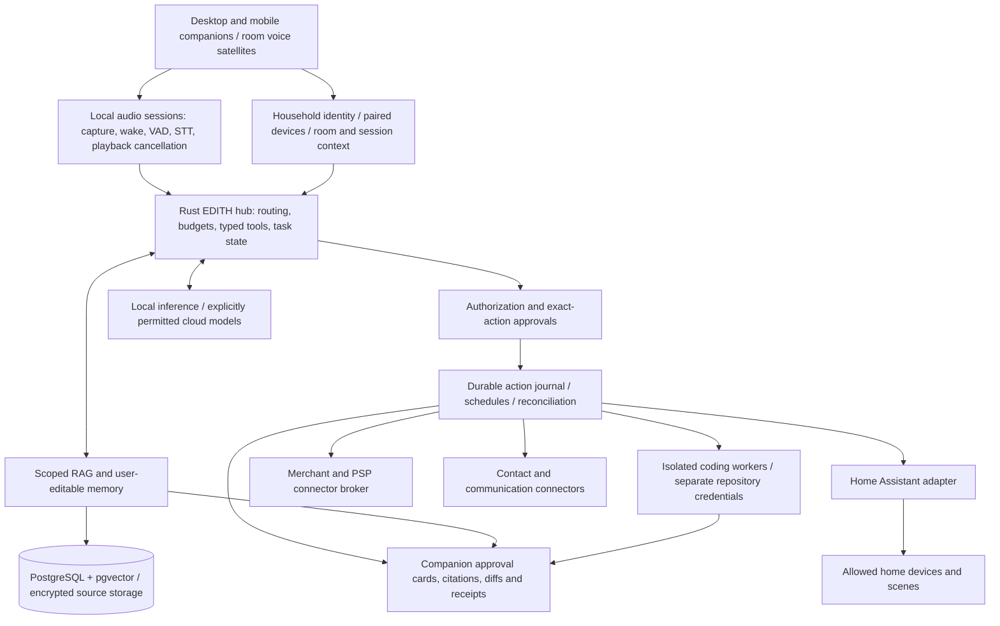

# EDITH: a central assistant for home, family and development

20 November 2026 · Updated against upstream commit `a006344dedf540b02ebbe8ad9d4cd9758ea039e0`

> **Implementation has advanced beyond this source baseline.** The active user goal now authorizes backend implementation while preserving the existing UI. A real `hub/` and Python integration have been added; the separate `prototype/` remains unfinished. See [implementation progress](implementation-progress.md) for verified current behavior and remaining requirements. Home Assistant installation is deferred at the user's request. The baseline tables below describe the pulled upstream version; they are not a claim that no new backend work exists.

The goal is a powerful speaking assistant that coordinates a home, helps develop software, supports children and elders, handles shopping and payments, helps contact people, and makes recommendations. This revision reflects the newly pulled Python application. The earlier [repository assessment](repository-assessment.md) describes commit `60fa113` and is historical; it is not an assessment of the current code. See the [updated code assessment](updated-code-assessment.md) for source evidence and limitations.

**Recommendation:** retain the new Python voice, model and integration code, and introduce a Rust coordination service in stages. Build one logical EDITH system with household identities, local home control, permission-aware RAG, specialized execution workers and replaceable models. “Centralized” means consistent context, permissions and task history across devices. The coordination service must own authorization and execution; adapters must not expose an alternative unrestricted path.

**Current status:** upstream is a substantial single-user Python desktop assistant, with wake-word listening, speech recognition/output, a tool loop, model fallback, preference memory, desktop automation and several integrations. Source implementation is established; live speech quality, external account connections and reliable completion have not been validated in this review. The separate local Rust/React prototype is **unfinished and paused**: `prototype/hub/src/app.rs` currently returns an empty router, and `lib.rs` exposes only that module. Its [contract](prototype-contract.md) describes intended behavior, not a working integrated product. No prototype work is being resumed by this documentation review.

## 1. Coverage of the complete requested vision

| Requested capability | Implemented in current upstream source | Remaining product work |
|---|---|---|
| Powerful speaking agent | Vosk wake detection, Whisper `small.en`, queued TTS, conversation loop, overlay and model routing | Interruptible generation/speech/actions, bounded microphone buffering, verified mute, room arbitration, multilingual/acoustic evaluation and typed fallback |
| Rust | Main application is Python; separate local Rust code is unfinished | Incremental Rust identity, session, policy, cancellation and durable task authority; keep Python inference/integration workers |
| RAG | Up to 200 plaintext facts, remember/forget, online fact extraction and notes | Document ingestion, permission-filtered retrieval, citations, freshness, scoped memory and deletion lineage |
| Central home system | Desktop Wi-Fi/Bluetooth/brightness and other PC controls | Home Assistant adapter, paired room clients, actual appliance/device matrix, verified state and offline recovery |
| Code development | Write saved scripts and run them with host-user permissions | Isolated repository workers, scoped credentials, reviewable diffs, meaningful build/test evidence and controlled publishing |
| Children play/learn | General-purpose conversation and media functions | Actual child identities, age-appropriate games/content, parent controls, spending/contact restrictions and evaluation |
| Help elders | Spoken replies and in-process reminders | Accessible controls, reliable cancellation/repeat, durable reminders, optional delegation and recovery from misunderstanding |
| Orders and payments | Generic browser/desktop tools; no dedicated validated commerce flow | Merchant carts, exact approvals, secure payment handoff, receipts, refunds/tracking and reconciliation |
| Contact people | Google email/calendar/tasks, contact-based WhatsApp desktop handoff, Telegram bot and Windows notification previews | Per-person accounts, precise recipient/content approval, verified outcomes, private reads/output, restricted remote tool access and call integration |
| Recommendations | Model answers, weather/Wikipedia functions and search-browser launching | Current source retrieval, evidence/price dates, constraints, quality evaluation and sponsorship disclosure |
| Handle everything centrally | One desktop process, shared memory and global tool registry; limited taught desktop macros | Authenticated members/devices, one task inbox, durable action journal, policy enforcement across all entry points, recovery and budgets |

These are complementary domains within one product. Phasing should improve their reliability and integration without quietly replacing the full vision with a website launcher.

### What can be reused immediately

Keep the voice pipeline, fast-path intent routing, tool schemas, provider adapters, Google/Telegram connectors and overlay as development assets. Their existing unit tests mainly exercise fakes; they are not evidence of live account access or hardware performance. Treat teach-by-showing as a limited linear macro recorder, not autonomous workflow learning: it captures keystrokes and click crops, compiles them online, and issues replay input without verifying every resulting state.

The first reliability work is concrete: replace broad “yes” matching with action-bound approval; verify foreground focus before typing; confine recipe image paths and validate steps; bound and clear microphone buffers; protect logs/tokens/private content; isolate script execution. Local model mode currently changes inference routing only: network-capable tools remain available. These fixes precede extending the existing tools to other family members.

## 2. Approaches considered

| Approach | Strength | Cost or limitation | Choice |
|---|---|---|---|
| Cloud-only assistant | Easy access to strong models; lightweight clients | Internet dependence, recurring audio/token cost, privacy and home-control outage exposure | Optional reasoning path, not the whole system |
| Entirely local assistant | Local data processing and resilience | Hardware cost; constrained inference speed/quality; model, voice and device support varies | Required option for suitable tasks and private data |
| Local hub plus optional cloud reasoning | Fast local actions and explicit selective escalation; one experience across devices | Needs routing, budget and data-boundary discipline | **Recommended** |

Do not promise “the most powerful model” as a permanent property. Choose models from measured task quality, language accuracy, latency, privacy compatibility and cost. Keep the provider interface replaceable so stronger models can be adopted without rewriting home permissions or payment handling.

## 3. Overall architecture

### Current application

The two Agent instances have separate conversation histories, but share the model router, memory and available skills. This is centralized within one desktop process; it is not yet a household hub. Credentials, member scopes and durable action state are not enforced by a separate authority. The repository's existing `GRAPH.md` describes the old application and is superseded by this current diagram.

### Target architecture

Migrate incrementally: stabilize the Python application first, place a narrow typed worker interface around its reusable adapters, then route execution through a modular Rust hub. Move one tested capability at a time. Once a tool is governed by the hub, neither voice, Telegram nor a taught macro may call it through an ungoverned alternative. A local hub is the execution authority for that home. Optional cloud services manage account synchronization, remote access and cloud inference only for explicitly shared data. Do not create competing home and cloud authorities that both execute the same delayed command after a network partition.

### Responsibilities and technologies

| Area | Proposed implementation | Why |
|---|---|---|
| Control service | Rust, Tokio, Axum, typed JSON schemas, bounded async queues | Robust concurrent sessions, explicit state and cancellation, narrow permissions around tools |
| Desktop companion | Retain current pywebview overlay during transition; complete the React/TypeScript companion, then evaluate a Tauri wrapper | Preserve working integration code while adding identities, review cards and accessibility; a wrapper is not itself authorization |
| Mobile/room clients | Companion UI and a voice-satellite protocol; select hardware after acoustic tests | Different form factors share the same identity/action engine |
| Speech/model workers | Retain Vosk, faster-whisper, pyttsx3 and current model adapters behind a typed interface; evaluate alternatives against measured gaps | Reuse current work; replace engines for latency/language/packaging evidence rather than language preference |
| Knowledge | PostgreSQL full-text search + pgvector, source-object store, ingestion workers | One transactional source of truth for ACLs, provenance, task metadata and retrieval |
| Local small-device storage | SQLite/WAL or an equivalent tested local transactional adapter where a standalone home installation does not need PostgreSQL | Lower footprint; keep a storage interface and migration path. Current plaintext stores and the unfinished prototype JSON code do not provide this guarantee |
| Long tasks | Persistent action journal initially; consider Temporal Rust for durable scheduling/retries at scale | Voice streaming stays on the low-latency path; external effects require explicit recovery semantics |
| Home integration | Home Assistant WebSocket/REST adapter with entity/service allowlists | Mature device ecosystem without rebuilding each appliance integration |
| External services | Reviewed APIs/MCP servers through an EDITH credential broker | Credentials remain outside model context; protocols do not replace authorization |
| Coding | Disposable checkouts inside a VM/container boundary with separate credentials and egress rules | Running repository tests/dependencies is code execution, not harmless reading |

[Axum](https://docs.rs/axum/latest/axum/) and [Tauri capabilities](https://v2.tauri.app/security/capabilities/) support these roles. [Temporal's Rust SDK is now generally available](https://temporal.io/blog/build-durable-applications-rust-temporal-rust-sdk-now-generally-available); its workflow replay constraints still require nondeterministic model/network operations to run as activities.

## 4. Voice: a conversation system, not just speech-to-text

Current voice code is a useful starting point, but waits through TTS and agent work without end-to-end interruption. The mute button filters consumed audio rather than stopping capture; the microphone queue is unbounded. First fix capture/mute and cancellation semantics, then benchmark the existing engines. First startup can download speech/wake/model assets; provision these before claiming offline readiness.

The production pipeline is microphone capture → acoustic echo cancellation → local wake detection or push-to-talk → voice activity detection → transcription → intent/model routing → authorized action → streamed speech. Maintain a turn ID and cancellation token across every stage.

- **Interruptions:** stop playback immediately when the user interrupts; cancel generation and ignore stale responses. A cancelled answer must not start speaking later. Cancellation of a submitted external payment/message is different: reconcile its status rather than claiming it was undone.
- **Multiple rooms:** pick one responding satellite for a wake event; use room context for “this light”; ask if the target remains ambiguous. No competing replies from three speakers.
- **Privacy:** physical mic mute where hardware permits; visible listening indicators; short in-memory pre-roll only; no stored recordings by default. Model/service connections are disclosed separately from microphone activation.
- **Output privacy:** an authorized adult may still need a private-device reply when children/guests are present. Do not read bank details, personal messages or private work documents aloud by default in a shared room.
- **Resilience:** typed controls and ordinary physical switches remain usable. Internet loss should leave supported local home commands operational; cloud-only appliances and cloud accounts cannot become offline by architectural intent.
- **Language:** evaluate English, Hindi and Telugu separately, including names, accents and mixed-language utterances. Availability of a language token is not an accuracy or pronunciation guarantee.

Home Assistant provides [Assist pipeline stages/events](https://contributors.home-assistant.io/core/internals/assist-pipelines/) and [local voice deployment guidance](https://www.home-assistant.io/voice_control/voice_remote_local_assistant/). Its published hardware examples illustrate why a small satellite should not be expected to run large open-ended speech models. [ESPHome voice modes](https://esphome.io/components/voice_assistant/) must be tested for actual interruption/echo behavior; continuous listening after playback is not the same as full-duplex barge-in.

The [Wyoming protocol](https://github.com/OHF-Voice/wyoming) has no built-in authentication/encryption. Use it behind the hub on localhost or a suitably isolated trusted network; it must not become an unauthenticated internet audio endpoint.

### Commercial licence selection

Maintain notices/provenance for code, models, voices, phonemizers, codecs and training sources where relevant. [openWakeWord](https://github.com/dscripka/openWakeWord) code and its supplied models have different terms: bundled models are noncommercial and are not a default commercial EDITH wake-word solution. [Current Piper licensing](https://github.com/OHF-Voice/piper1-gpl/blob/main/docs/LICENSING.md) likewise requires separate attention to engine distribution and voice rights. GPL permits sale but imposes obligations; a model card is not automatic clearance of every underlying right. [whisper.cpp](https://github.com/ggml-org/whisper.cpp) and [sherpa-onnx](https://github.com/k2-fsa/sherpa-onnx) are candidates whose exact model/runtime distributions must still be reviewed.

## 5. RAG and memory

Current `brain/memory.py` holds a single plaintext list of up to 200 facts, all inserted into the prompt. Notes are also read as plaintext. Keep explicit remember/forget interactions, but migrate data with owner and visibility decisions; do not silently classify old facts as safe for every household member. Neither store currently implements document RAG.

RAG supplies evidence to a model; it does not itself create intelligence, truth or permission to act. Keep document retrieval separate from task execution and user identity.

### Ingestion

Accept explicitly selected documents, folders or connected sources. Parse in an isolated worker, normalize text, retain page/section references, compute source hashes, chunk by meaningful boundaries, create embeddings and index keywords. Store owner, household/team, ACL/version, creation/update time, parser version, chunk location and model version. Unsupported/password-protected files must produce an honest status, not an empty “success.”

### Retrieval and answering

1. Establish the authenticated principal and permitted personal/household/work scopes.
2. Apply permissions to keyword and vector searches **before** content reaches reranking, caches, model prompts or logs.
3. Retrieve/rerank a small evidence set; check source freshness and conflicting versions.
4. Answer with citations to actual source sections. Say when the evidence is missing or conflicting.
5. Recheck citation access before opening a source; a formerly authorized response must not bypass later revocation.

PostgreSQL's [row security](https://www.postgresql.org/docs/current/ddl-rowsecurity.html) can default-deny, but privileged roles/table owners can bypass policies. Use a restricted application role and adversarial cross-user tests. [pgvector filtering](https://github.com/pgvector/pgvector#filtering) also affects approximate-search recall; begin with exact search within permitted subsets where feasible, then evaluate tenant partitions/ANN for larger datasets. Retrieval quality and authorization are separate problems.

### Memory classes

| Memory | Example | Retention/control |
|---|---|---|
| Explicit preference | Preferred language, speech speed, vegetarian meals | User-visible, editable and removable |
| Source-backed fact | Appliance model or delivery instruction | Source, timestamp and verification status |
| Task state | Pending cart comparison | Tied to a task; expires |
| Inference | Possibly likes a genre | Mark uncertain; do not silently promote to fact |
| Conversation summary | Relevant previous context | Inherits source visibility and deletion lineage |

“Forget this” must invalidate derived summaries, embeddings, caches and pending tasks that reuse it. A household administrator does not automatically gain access to an adult's private medical, financial, email or work data. Household and business workspaces remain separate even when used by the same person. Encrypt stored secrets and sensitive source data; define backup retention and deletion propagation instead of implying instant erasure from all backups.

## 6. Identity, permissions and actions

Current skill flags provide confirmation on selected actions, and the voice callback accepts any transcript containing the token “yes.” Google tokens and memory are shared; Telegram checks a configured chat ID without checking the sender or private-chat type. There is no durable approval object or member authority. Generic keyboard, terminal-launch and desktop inputs also need policy: protecting only named payment or script tools leaves equivalent effects available through other tools.

Use paired devices and real authenticated identities in the product. Speaker recognition can select a profile or suggest personalization; it must not by itself authorize spending, private disclosures or destructive changes. Guests receive a restricted session. A child cannot gain adult privileges by saying “I am the parent.”

Capable elders control their own data and actions. Assistance/delegation is opt-in, specific and revocable. A household owner manages device/service administration, not ownership of everyone else's private conversations.

| Action class | Product policy |
|---|---|
| Read public facts, curated games, low-risk allowed home actions | Standing permission may suffice |
| Read private notes or accounts | Authenticated identity, source scope and appropriate output destination |
| Change a scene or create a reminder | Resolve targets/time; preview or standing grant according to consequence |
| Send a message/call, place an order, spend money, publish code, destructive change | Exact, fresh approval by the authorized person through a trusted device/interaction |
| Locks, alarms, heating/safety-critical appliances | Device-specific policy and testing; never assume a generic home-control permission covers them |

The durable action record should contain principal, tenant, tool/version, canonical argument hash, policy version, prepared state, approval reference/expiry, idempotency key, external operation ID and completion evidence. Proposed states:

`proposed → validated → prepared → awaiting approval → executing → verified → completed`

Also represent rejected, cancelled, failed and **unknown external outcome**. An accepted API request is not proof that a lamp changed, a message arrived or an order was placed. Reconcile authoritative external state. Do not retry an uncertain payment as a brand-new payment. [Temporal's idempotency guidance](https://docs.temporal.io/activity-definition) explains why retries do not automatically imply exactly-once effects.

Retrieved text, webpages, emails, repository files and tool output remain untrusted data. They cannot grant new permissions or override the user's task. The model proposes typed operations; ordinary application code validates and authorizes them. Tool descriptions and MCP annotations are not inherently trustworthy. Use scoped credentials, schema/version pinning and audience validation; current [MCP security guidance](https://modelcontextprotocol.io/docs/2026-07-28/tutorials/security/security_best_practices) explicitly requires state handles to be bound to the authenticated user.

## 7. Home integration

No Home Assistant connector or actual household device control was found in this upstream version. PC brightness, Wi-Fi and Bluetooth controls should remain separately labelled desktop capabilities.

Home Assistant should remain the owner of device drivers and ordinary automations. EDITH subscribes to permitted entity state, exposes a small typed set of tools and checks postconditions. Use a dedicated least-privilege integration identity where supported; never hand the entire Home Assistant token to the model. Some platforms' token scoping is coarse, so EDITH's server-side allowlists remain necessary.

Start with lights, plugs and fans in a tested device matrix. Add scenes and sensor-driven routines only after cancellation, conflicts and offline recovery tests. Keep a manual switch/control path. A stored scene must not grow new high-risk actions without renewed authorization.

[Matter](https://www.home-assistant.io/integrations/matter/) and [ZHA](https://www.home-assistant.io/integrations/zha/) help with coverage, but Thread border routers, Zigbee coordinators, local networking and firmware compatibility remain real dependencies. “Supports Matter/Zigbee” is not “works with every appliance.” Commissioning or resetting devices must be a deliberate installation step.

## 8. Coding assistance

Current tools can write and execute scripts using the host user's permissions. Keep that capability confined to deliberate developer experiments until isolation is implemented. Give development its own workspace and tools: repository discovery, source/symbol search, dependency explanation, proposed changes, patch generation, build/test execution, failure analysis and reviewable diffs. Every change starts from a known commit; report exact checks and their limits. Publishing/merging/deploying is a distinct action.

Run tests and dependencies in a disposable execution environment with CPU/RAM/time limits and controlled network access. Never mount the home hub's browser profile, contacts, payment secrets, SSH agent or unrestricted filesystem into it. A Git branch/worktree separates changes, **not security**. On Windows, a configured VM or [Windows Sandbox](https://learn.microsoft.com/en-us/windows/security/application-security/application-isolation/windows-sandbox/windows-sandbox-configure-using-wsb-file) is an evaluation option; production Linux workers can use stronger VM isolation such as [Firecracker](https://github.com/firecracker-microvm/firecracker). Neither is a one-click guarantee of secure execution.

Developer knowledge can include code, issues and documentation through explicit repository/workspace access. Code comments and test output can contain prompt injection. A coding worker may return a diff and test evidence; it must not acquire unrelated household capabilities. A read-only source explorer is a useful first boundary; the local prototype's explorer code is not yet integrated into a working Rust service.

## 9. Children and elder experience

Children's features should include curated word/math games, stories, collaborative family play, age-banded explanations and parent-selected topics. Keep sessions bounded with helpful breaks. No targeted advertising, commercial persuasion or hidden purchases. Avoid manipulative exclusivity or claims that EDITH replaces family/friends. Generated child-facing content needs separate evaluations and controls before replacing curated content.

Parents control child accounts and connected capabilities. Household-sharing and child-suitability are distinct production decisions: an adult-shared document is not automatically child-approved. These controls are absent from the current upstream application. The paused prototype contract also requires adult confirmation before a note becomes visible to every demo profile; that is a requirement, not verified runtime behavior. Profile changes must cancel or invalidate in-flight answers, not merely clear the existing transcript. Do not store raw child audio or build undisclosed behavioral profiles by default. India's statutory child definition and processing requirements need careful implementation: the [DPDP Act](https://www.indiacode.nic.in/bitstream/123456789/22037/1/a2023-22.pdf) and [commencement notification](https://www.meity.gov.in/static/uploads/2025/11/c56ceae6c383460ca69577428d36828b.pdf) schedule the relevant sections including section 9 for 13 May 2027. As of this document's date, do not falsely describe every provision as already in force; build readiness for the actual launch date and processing model.

Elder-friendly mode includes large controls, captions, slower adjustable speech, repeat-last-answer, simple confirmation cards, reversible steps and clear error recovery. Current reminders use in-process timers and disappear on restart; durable scheduling, acknowledgment and recovery remain necessary. Do not infer cognitive incapacity from age. Trusted-contact escalation is a separately configured permission. Reminders are helpful but not guaranteed medication adherence or emergency monitoring; EDITH should not be sold as an emergency service without a separate validated system.

## 10. Shopping, payment, contact and recommendations

### Shopping and payment

Separate a shopping list from a priced cart and a payment from a confirmed order. A purchase approval must cover merchant, items/quantities, substitutions, delivery address, full price/fees and relevant cancellation terms. Changed terms invalidate approval. COD and stored-wallet transactions still commit spending.

Hand authentication to the trusted merchant/PSP/UPI UI. EDITH must never ask users to speak or reveal a UPI PIN, OTP or password to the model. A QR/payment link is not proof of payment; verify payment and order state through the authorized service and keep receipts/status.

An official Swiggy integration is a viable candidate: its [developer documentation](https://mcp.swiggy.com/builders/docs/start/developer/) describes MCP and OAuth onboarding, with production access/review gates. Its [UPI recipe](https://mcp.swiggy.com/builders/docs/build/recipes/pay-with-upi/) documents payment handoff and subsequent status checks. These interfaces are potential integrations, not access already granted to EDITH. Amazon's [Selling Partner API](https://developer-docs.amazon.com/sp-api/docs/onboarding-overview) is for seller/vendor operations and does not establish an unrestricted consumer checkout API.

### Contacts and messages

Reuse the existing Google and Telegram adapters and contact lookup. Current WhatsApp automation opens a deep link, attempts window focus and presses Enter; it does not establish delivery or verified recipient state. Windows notification previews are not conversation-history access. The existing Naukri scheduler is a separate personal workflow; its saved browser profile should not imply household-wide consent to recurring actions.

Access each person's contacts only with their permission. Resolve ambiguous names, confirm the exact recipient/channel/content, then hand off to a phone app or approved sending connector. Report sent/delivered/failed/unknown distinctly. Never infer authorization to message all contacts from a general request for a capable assistant.

Do not promise a general-purpose EDITH WhatsApp bot in India: Meta's current [AI-provider documentation](https://developers.facebook.com/documentation/business-messaging/whatsapp/pricing/ai-providers/) limits that use to specified markets that do not include India. Business notifications and personal-device handoffs are different products and must follow their own terms. [Twilio's India voice guidance](https://www.twilio.com/en-us/guidelines/in/voice) also has route/caller-ID restrictions and no emergency calling support. Native phone handoff is often a better first step than pretending EDITH has an unrestricted local telephone service.

### Recommendations

Use stated preferences and authorized history, retrieve current sources/catalogue information, and explain why an option fits. Show price/availability timestamps and uncertainty. Label sponsored results. Dietary/allergy suitability cannot be inferred from missing merchant ingredients. Recommending an item is separate from authorizing its purchase. Do not turn a discussion with a child into a sales funnel.

## 11. Hardware, deployment and cost model

This development PC has approximately **24 GB RAM, an Intel i7-9700K and Intel integrated graphics**. It is a reasonable CPU prototype host for a compact quantized model; it does not justify a claim of frontier-model speed or far-field voice quality. Large reasoning/coding models require more capable local hardware or an explicitly permitted cloud route.

Use an existing PC and headset first. Select a dedicated always-on hub, microphones/satellites and radios only after measuring rooms, distance, noise, concurrency and offline requirements. Separate one-time hardware/install cost from monthly software/usage. A room microphone is an audio endpoint, not a substitute for the inference host.

The production cost equation is:

`hosting + storage/backups + audio input/output + model tokens + embedding/ingestion + search/tool calls + telephony/messages + payment processing for EDITH subscriptions + support + hardware amortization`

Household merchant payments are not the same as EDITH subscription billing. Cloud usage scales with active audio/tokens and task complexity, not just household count. Thirty minutes/day is roughly 900 minutes/month; three hours/day is about 5,400. Children playing and long conversations can make “unlimited voice” financially unsafe.

Example **sensitivity**, not a vendor quote: at an all-in variable voice cost of ₹0.50/minute, 900 minutes costs ₹450; at ₹2/minute it costs ₹1,800 before support and fixed expenses. Measure actual input/output audio ratios, reasoning tokens, retries and task success before setting included allowances. The small-business plan's ₹999/PC and ₹5,000 operating envelope do not establish an all-inclusive price for this much broader household product.

A commercial experiment could test separate tiers for local core features, household cloud allowances and developer workloads. Prices require real provider quotes and pilot usage; do not advertise an unlimited ₹499 or ₹999 service without a measured cost ceiling. The unfinished prototype was intended to use local inference. The upstream application supports both remote and local providers; this review has not validated an account, measured current usage charges or demonstrated its local inference path. A previously tested standalone Ollama model does not validate upstream's separate llama-cpp-python runtime.

Operational requirements include signed updates, migration/rollback, per-home pairing, encrypted backup/restore, uptime/queue/latency monitoring, certificate/secret rotation, connector token revocation, per-family spend limits and opt-in redacted diagnostics. A cloud outage should not disable local switches or trap a user behind a subscription error. If failover cannot determine whether an external action occurred, show an unknown state and reconcile.

## 12. Build sequence preserving the full scope

The new application already provides valuable voice, model and tool foundations. Build on those foundations; do not restart with an empty Rust rewrite. The stages below are a proposed sequence, not authorization to resume the paused prototype or a claim that these features are complete. Calendar estimates require an agreed team and measured baseline after Stage 0.

| Stage | Main deliverable | Exit evidence |
|---|---|---|
| 0. Reproducible single-user baseline | Pin a working runtime/dependency set; reconcile setup docs; verify configured model APIs; fix approval parsing, foreground checks, recipe validation and microphone capture behavior | Selected unit tests plus controlled local end-to-end scenarios; no accidental input after focus failure; negated/expired approval rejected; no retained muted audio; explicit capability report |
| 1. Shared authority and first integrated slice | Rust hub with member/session identity, policy, durable journal, cancellation and bounded worker interface; reuse Python adapters and finish only the needed companion screens | One authenticated member completes voice → proposed action → trusted approval → worker → verified result → persisted receipt; rejection/restart/duplicate tests; both voice and Telegram use the same enforcement |
| 2. Real home and knowledge | Home Assistant adapter, one tested room, selected document ingestion, scoped retrieval/citations and memory migration | Physical device state verification; private document isolation; deletion/revocation; local operation through internet outage where supported |
| 3. Coding and household experience | Isolated coding workers; child accounts/curated play/content evaluation; elder accessibility and opt-in delegation | Reviewable patch with real test evidence; worker isolation tests; parent/elder usability sessions; durable reminder restart tests |
| 4. Commerce and communication | Harden existing messaging/account adapters; add approved merchant/cart/payment handoff and order reconciliation | Approved recipient/content; changed price invalidates approval; timeout/duplicate tests; authoritative receipts and clear unknown outcomes |
| 5. Field pilot and product operations | Multiple rooms/languages/households, packaging, signed updates, backups, support, usage budgets and subscription operations | Noise/interruption benchmarks, task success/cost data, restore/update drills and reliable degraded behavior |

For the next working demonstration, select **one voice-controlled allowed home action and one private document answer**, with visible identity, approval when required, cancellation and source/outcome evidence. If hardware is unavailable, label the action as simulated and keep the physical-device acceptance gate open. Add the rest of the vision through the stages above; the demonstration must not be presented as the full household product.

A useful staffing model remains a platform engineer, an AI/voice/RAG engineer, a frontend/integration engineer and dedicated QA/product work. The earlier six-to-nine-month beta range was a preliminary planning assumption, not a delivery commitment or a measured estimate of remaining work. Re-estimate after reproducing this version and selecting pilot languages/devices/connectors. Each language and high-consequence connector has its own acceptance work.

## 13. Evaluation and release gates

Maintain a versioned scenario suite independent of any single model provider. Test real postconditions, not the fluency of an answer.

- Voice: transcription/intent accuracy by language and speaker group, p50/p95 time to first response, interruption success, false wakes, two-room contention, noisy TV and echo scenarios.
- RAG: relevant authorized evidence, citation correctness, missing-evidence abstention, conflicting/stale documents, cross-user leakage, revocation and deletion propagation.
- Actions: precise target/parameters, approval freshness, profile/permission changes, duplicate requests, idempotency, timeout/unknown outcome and restart reconciliation.
- Home: actual resulting entity/device state, offline behavior, command conflicts and manual override.
- Coding: meaningful tests, bounded file changes, malicious repository instructions, secret isolation, egress and resource limits, reviewable artifacts.
- Children: content by age band, bypass attempts, no commercial tools, non-manipulative language, session boundaries and parental controls.
- Elders: readable controls, speech/caption usefulness, misunderstanding recovery, voluntary assistance and independently authorized spending.
- Commerce/comms: changed price/recipient invalidates approval; pending is never labelled completed; provider confirmation and receipt are retained without exposing secrets.
- Operations: cost per successful task, support burden, restore/update rollback, secret revocation and safe degraded operation.

Finite tests do not prove zero risk. Add adversarial documents, tool output and interrupted workflows; repeat model evaluations and inspect failures. Publish only capabilities and performance that the installed product has demonstrated. Keep source review, mocked unit tests, synthetic component checks and real end-to-end results separately labelled. The current review did not run the assistant, access live accounts, record audio or certify the unfinished prototype; see [review evidence](current-review-evidence.json).

## 14. Decisions to resolve with pilot users

The blueprint preserves the complete requested ambition. Practical choices still require observation: number of rooms/users; appliance brands; preferred languages and privacy modes; acceptable dedicated-hub cost; whether cloud processing is allowed for each data category; initial merchant/contact channels; and developer repository execution requirements. The existing implementation is enough to begin a measured single-user baseline. These product choices and the missing controls still prevent a claim of a production-ready connected household.
